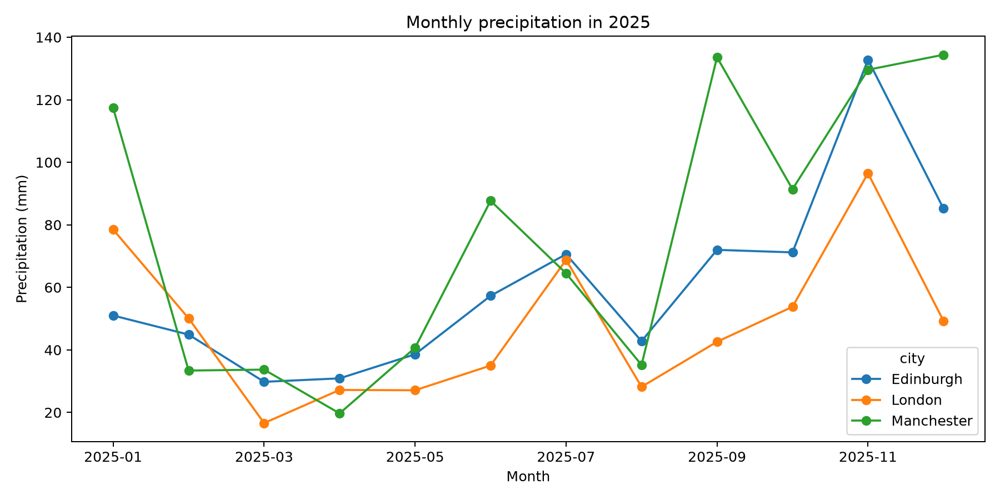

# Historical Weather API and PostgreSQL Pipeline

## Problem and intended reader

Compare historical weather exposure at three UK locations while demonstrating a repeatable data pipeline: API retrieval, validation, source archiving, transactional database loading, replay checks and reporting.

The intended reader is an analyst or operations team deciding what further seasonal investigation is needed. This is an independent learning project, not a model of actual delivery delays or an official warning system.

## Data source and scope

Data: [Open-Meteo Historical Weather API](https://open-meteo.com/en/docs/historical-weather-api), using ERA5 reanalysis from ECMWF/Copernicus Climate Change Service. Attribution and terms are recorded in [DATA_SOURCE.md](DATA_SOURCE.md).

- Period: 1 January–31 December 2025.
- Retrieval date: 16 November 2026.
- Representative points: London, Manchester and Edinburgh.
- Coverage: 365 days per point; 1,095 daily observations.
- Timezone requested: Europe/London.
- Units: °C, mm and km/h.

These are modelled point estimates, not direct station measurements or city-wide conditions. API data is provided under CC BY 4.0; the free service has separate non-commercial usage conditions.

## Metric definitions

One daily row is identified by (city, day). Monthly temperature is the mean of daily mean temperatures. Monthly precipitation is the sum of daily precipitation, including the water equivalent of snow.

- Wet days: precipitation ≥10 mm.
- Windy days: daily maximum wind speed at 10 m ≥40 km/h.

These are illustrative screening thresholds, not official warnings or counts of business disruptions. [DATA_DICTIONARY.md](DATA_DICTIONARY.md) defines all fields.

## Method

pipeline.py requests the fixed year for each city with explicit model, unit and timezone parameters. It retries selected temporary HTTP failures and validates ordered dates, units, array lengths and numeric values.

Accepted responses and retrieval metadata are saved locally. All cities are validated before normal database writes begin. An upsert on (city, day) writes observations and a successful run record within one transaction.

On replay, existing observations are updated rather than duplicated. Load timestamps, response hashes and run records can change. Failed runs are logged to a file and, when a usable connection exists, to the database.

report.py reads 2025 observations and generates monthly_weather.csv and monthly_rain.png. SQL queries provide coverage and independent report checks.

## Findings

| City point | Days | Annual precipitation (mm) | Days ≥10 mm | Days ≥40 km/h |
|---|---:|---:|---:|---:|
| Manchester | 365 | 921.3 | 22 | 8 |
| Edinburgh | 365 | 727.1 | 12 | 9 |
| London | 365 | 573.7 | 15 | 4 |

Manchester had the highest annual precipitation at these selected points. Its wettest month was December, at 134.4 mm. Edinburgh and London peaked in November, at 132.8 mm and 96.5 mm.

London had more days reaching 10 mm than Edinburgh despite lower annual precipitation. Threshold frequency and annual volume describe different aspects of exposure.



Sources: [Annual summary](outputs/annual_weather.csv) and [monthly summary](outputs/monthly_weather.csv). Full interpretation: [FINDINGS.md](FINDINGS.md).

## Validation, recommendations and limitations

- Four supplied validation tests passed.
- The replay export shows 1,095 daily observations and two successful runs.
- The London January SQL spot check matches the Python report.
- Submitted raw response hashes and independently recomputed summaries match.
- The file log records the host-setting error and deliberate connection failure.
- I confirmed that ROLLBACK preserved the original value after the negative-precipitation constraint exercise.

See [DATA_QUALITY.md](DATA_QUALITY.md) for evidence and verification limits and [DECISIONS.md](DECISIONS.md) for reasoning.

One year at three points cannot establish long-term climate rankings or business impacts. Further analysis needs multiple years and matched business outcomes, routes, workloads and service commitments.

Scheduling is not configured. No independent extension is claimed. The code does not provide monitoring alerts, complete observation revision history or production deployment guarantees.

## Reproduction

### Python setup

Use Python 3.13 and a local PostgreSQL installation. From the project folder in Windows PowerShell:

```powershell
py -3.13 -m venv .venv
.\.venv\Scripts\python.exe -m pip install -r requirements-lock.txt
New-Item -ItemType Directory -Force data\raw, outputs, logs
.\.venv\Scripts\python.exe -m unittest -v test_pipeline.py
```

The submitted requirements-lock.txt records the author's installed versions. A fresh installation of that exact environment was not tested during review. requirements.txt contains the course's broader version bounds.

### Database setup

Create weather_portfolio owned by the existing portfolio_user login through an administrator connection. Connect as portfolio_user, open Query Tool on weather_portfolio and verify:

```sql
SELECT current_database(), current_user;
```

Run the complete schema.sql file. On a new database, weather_daily and pipeline_runs should each contain zero rows.

### Validate and load

First validate the real API responses without database writes:

```powershell
.\.venv\Scripts\python.exe pipeline.py --validate-only
```

In the same PowerShell terminal, set connection details. The example uses port 5433; replace it with the port shown in your working pgAdmin connection. The host is localhost, not a port number.

```powershell
$env:PGHOST = 'localhost'
$env:PGPORT = '5433'
$env:PGDATABASE = 'weather_portfolio'
$env:PGUSER = 'portfolio_user'
.\.venv\Scripts\python.exe pipeline.py
```

Enter the portfolio_user password at the hidden prompt. Do not store it in source code or commit password files.

Verify 365 records per city and 1,095 rows for 2025. Repeat the same pipeline command, then export:

```sql
SELECT
    (SELECT COUNT(*) FROM weather_daily
     WHERE day >= DATE '2025-01-01'
       AND day < DATE '2026-01-01') AS daily_rows,
    (SELECT COUNT(*) FROM pipeline_runs
     WHERE status = 'success') AS successful_runs;
```

The observation count should remain unchanged while successful_runs increases by one. processed_rows counts submitted input records, not newly inserted rows.

### Reporting

Run each statement in analysis.sql and export coverage and recent-run results. Generate the Python report:

```powershell
.\.venv\Scripts\python.exe report.py
```

Check 36 city-month rows. Compare London January with:

```sql
SELECT city, COUNT(*) AS days,
       AVG(mean_temp_c) AS mean_temp_c,
       SUM(rain_mm) AS rain_mm,
       COUNT(*) FILTER (WHERE rain_mm >= 10) AS wet_days,
       COUNT(*) FILTER (WHERE max_wind_kmh >= 40) AS windy_days
FROM weather_daily
WHERE city = 'London'
  AND day >= DATE '2025-01-01' AND day < DATE '2025-02-01'
GROUP BY city;
```

Export the annual summary with:

```sql
SELECT city, COUNT(*) AS days,
       ROUND(SUM(rain_mm)::numeric, 1) AS precipitation_mm,
       COUNT(*) FILTER (WHERE rain_mm >= 10) AS wet_days,
       COUNT(*) FILTER (WHERE max_wind_kmh >= 40) AS windy_days
FROM weather_daily
WHERE day >= DATE '2025-01-01' AND day < DATE '2026-01-01'
GROUP BY city ORDER BY precipitation_mm DESC;
```

Save these results to outputs/report_spot_check.csv and outputs/annual_weather.csv. Future API revisions may change values; preserve new metadata rather than forcing agreement with these results.

### Optional scheduling

run_daily.cmd is supplied as an optional template and has not been deployed or verified. Before using it, configure its actual host/port and an appropriately protected local password file outside the repository. No scheduled task or automatic alerting is claimed.

## Project files

| File | Purpose |
|---|---|
| pipeline.py | Retrieve, validate, archive and upsert weather |
| schema.sql | Daily observations and run-history tables |
| test_pipeline.py | Four payload-validation tests |
| analysis.sql | Coverage, monthly weather and run-history queries |
| report.py | Monthly CSV and chart generation |
| run_daily.cmd | Optional, unconfigured refresh template |
| requirements.txt / requirements-lock.txt | Package bounds / recorded versions |
| outputs/ | Reports, evidence exports, chart and source manifest |
| DATA_SOURCE.md | Source attribution, terms and retrieval metadata |
| DATA_DICTIONARY.md | Fields, units and metrics |
| DATA_QUALITY.md | Review evidence and limitations |
| DECISIONS.md | Decisions and troubleshooting |
| FINDINGS.md | Historical weather interpretation |

Raw responses and local logs remain in the working project and are excluded from publication. outputs/source_manifest.json preserves the submitted request URLs, retrieval timestamps and hashes.

## Assistance

I used the course implementation and AI assistance for guidance, troubleshooting, validation and documentation. I ran the manual pipeline and reporting workflow locally. The final review independently checked saved responses and results without connecting to my database.
